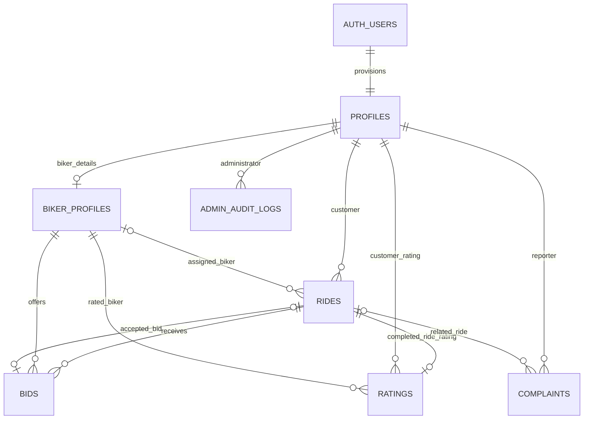

# Database design and authorization

## Relationships

| Table | Purpose and important rules |
| --- | --- |
| profiles | UUID primary key references `auth.users.id`. Private name, mobile, gender, app role, account status, and timestamps. Email/password remain in Supabase Auth and are not duplicated here. |
| biker_profiles | Same UUID references profiles. Motorcycle model, unique plate, availability, timestamps. Only biker profiles can have a row. Going online requires vehicle details. |
| rides | Customer owner, request idempotency key, pickup/destination labels and coordinates, route measurements, NUMERIC fares, optional assigned biker/bid, lifecycle timestamps. |
| bids | Ride, biker, NUMERIC amount, status, timestamps. One record per ride/biker. A pending offer can be revised in that record. |
| ratings | One rating per completed ride, matching customer and assigned biker. Score 1–5, optional feedback, database creation timestamp. |
| complaints | Reporter, optional participating ride, subject/body, review status, administrator handler, resolution note/time, timestamps. |
| admin_audit_logs | Append-only client-access model recording status changes, complaint review, and administrative ride cancellation. Actor, target UUID, constrained action, minimal JSON details, creation timestamp. |

All identifiers are UUIDs. Timestamps are TIMESTAMPTZ, generated by PostgreSQL; update triggers maintain `updated_at` on mutable records. Money uses NUMERIC(10,2), positive and below 1,000,000, rejecting NaN as well as negative values. Latitude/longitude have explicit bounds. Distance is integer meters; duration is integer seconds.

Foreign keys restrict deleting historical business participants. Deleting an Auth user cascades only to its profile and biker details; if rides, bids, ratings, complaints, or audit history depend on that identity, deletion is rejected. Account removal therefore needs a later explicit retention/anonymization workflow.

The accepted-bid composite foreign key includes ride ID, biker ID, and amount, so a ride cannot reference another ride's bid or a different fare. Ratings use both a participant-matching composite FK and a trigger checking completed status. Later ownership drift cannot invalidate an existing rating silently.

## State and uniqueness

Ride lifecycle: `open -> assigned -> in_progress -> completed`. Customers can cancel open/assigned rides. Administrators can cancel open/assigned/in-progress rides for exception handling. Only the assigned active biker can start/complete a ride. Completed/cancelled rides cannot be reopened by the provided API.

Partial unique indexes enforce one active ride per customer, one assigned/in-progress ride per biker, and one accepted bid per ride. A unique customer/request-key pair prevents duplicate ride creation on retries. The client must reuse that UUID when retrying the same submission; a new intended request uses a new UUID.

`accept_bid` locks ride, selected bid, and biker profile, verifies customer ownership and biker availability, closes competing bids, assigns the selected fare, and marks the biker offline in one transaction. Selecting the same bid again while assigned returns the same ride ID. Selecting a different bid is rejected. These operations have no external side effects inside the transaction.

Indexes cover role/status filtering, available bikers, customer/biker ride history, open-request ordering, ride/biker bids, biker ratings, reporter/status complaint queues, relevant FKs, and audit actor/target lookups. No spatial extension, live tracking, payments, or advanced analytics is included.

## RLS and table privileges

All seven exposed tables have RLS enabled. Anonymous users have no table privileges. Authenticated users have SELECT grants only; RLS narrows the readable rows. There are deliberately no ordinary client INSERT/UPDATE/DELETE grants or write policies. Sensitive writes use checked SECURITY DEFINER RPCs.

The app role (`customer`, `biker`, `admin`) comes from protected profiles, not editable user metadata or a client request. `authenticated` is the PostgreSQL/JWT API role shared by signed-in users; it is not equivalent to Administrator.

| Resource | Customer | Biker | Active administrator |
| --- | --- | --- | --- |
| profiles | Own row, including when suspended | Own row, including when suspended | All rows |
| biker_profiles | No other user's row | Own row, including when suspended | All rows |
| rides | Own rides while active | Own assigned rows while active; open discovery through limited projection RPCs while online/available | All rows |
| bids | Bids on own rides while active | Own bids while active | All rows |
| ratings | Own ratings while active | Ratings for own completed rides while active | All rows |
| complaints | Own reports while active | Own reports while active | All rows |
| audit logs | None | None | All rows |

Open discovery now returns only ride ID, labels, permitted measurements, expected fare, status and timestamp through `list_biker_rides` / `get_biker_ride`. It excludes customer UUID, transaction key and customer contact/profile information. `ride_availability_events` has only ride ID, availability and timestamp, with RLS allowing available bikers; it supplies Realtime invalidations. Competing bids and other bikers' private details remain hidden. See [biker dashboard](biker-dashboard.md).

`get_bidder_summaries` allows a customer to see display names, motorcycle models, and average ratings only for actual bidders on that customer's ride. It returns no mobile, email, gender, plate, or account-status fields. Complaint targets do not gain access to another person's report.

Suspension makes the private caller-role helper return NULL, denying business reads/writes and administrative access. The owner can still read their own profile/status so an eventual UI can explain suspension. Suspending a biker also sets availability offline.

## Function boundaries

Private role/read helpers are SECURITY DEFINER to avoid recursive profile RLS. They use `auth.uid()`, inspect only caller authorization, pin `search_path = ''`, and qualify application objects. Only the helpers required by policies are executable by authenticated users; trigger/internal helpers are not client executable. Keep `private` outside exposed API schemas.

Public business functions derive ownership from the authenticated caller. They do not accept arbitrary owner, reporter, role, account-status, or timestamp values for self-service operations. Admin function EXECUTE is granted to authenticated users but each function first requires a current active administrator profile; a customer knowing its name cannot use it.

The database owner and Supabase service role are trusted and can bypass RLS by design. Neither a database credential nor a service/secret API key belongs in the mobile/admin apps. Definer functions bypass row filters only after their explicit checks. RLS was never disabled to make an operation pass.

| RPC | Allowed caller / operation |
| --- | --- |
| update_my_profile | Active owner: name, mobile, gender only |
| update_my_motorcycle | Active biker: own vehicle fields |
| set_biker_availability | Active biker with required vehicle details; no active assignment when going online |
| post_ride | Active customer; own owner ID and database timestamps |
| submit_bid | Active available biker; open request with active customer; revise own pending offer |
| accept_bid | Active owning customer; atomic selection |
| transition_ride | Assigned biker starts/completes; owning customer or admin cancels within allowed states |
| rate_ride | Active owning customer; completed ride only, once |
| submit_complaint | Active caller; optional ride must involve that caller |
| admin_set_account_status | Active administrator; customer/biker accounts only, audited |
| admin_review_complaint | Active administrator; handler/status/resolution recorded and audited |
| get_bidder_summaries | Active owning customer; minimal bidder display data |
| backend_health | Anonymous or authenticated; application/version/time only |

Use the SQL definitions for exact argument names/types. A dedicated administrator is provisioned only by a trusted project operator; public signup metadata is restricted to Customer/Biker. Subsequent metadata edits do not change roles.

## Repeating authorization tests

`npm run db:test` replays migrations and the development seed in ephemeral PostgreSQL, then executes 101 SQL assertions under actual `anon`/`authenticated` roles with controlled caller UUIDs. The test-only Auth shim stands in for signed claims; it does not verify JWT cryptography. The SQL file also runs on a fresh seeded local Supabase database using `npm run db:test:local`.

Before hosted release, repeat HTTP checks with independent signed-in customer A/customer B/biker A/biker B/admin clients. Confirm private rows and competing bids stay hidden, direct writes fail, wrong-role RPCs fail, suspension takes effect, and duplicate/foreign-key constraints remain enforced. Repeat simultaneous assignment attempts using two independent PostgreSQL connections; the single-connection WASM runner does not establish concurrency behavior.

RLS references: [Supabase row security](https://supabase.com/docs/guides/database/postgres/row-level-security), [securing database functions](https://supabase.com/docs/guides/database/functions).
